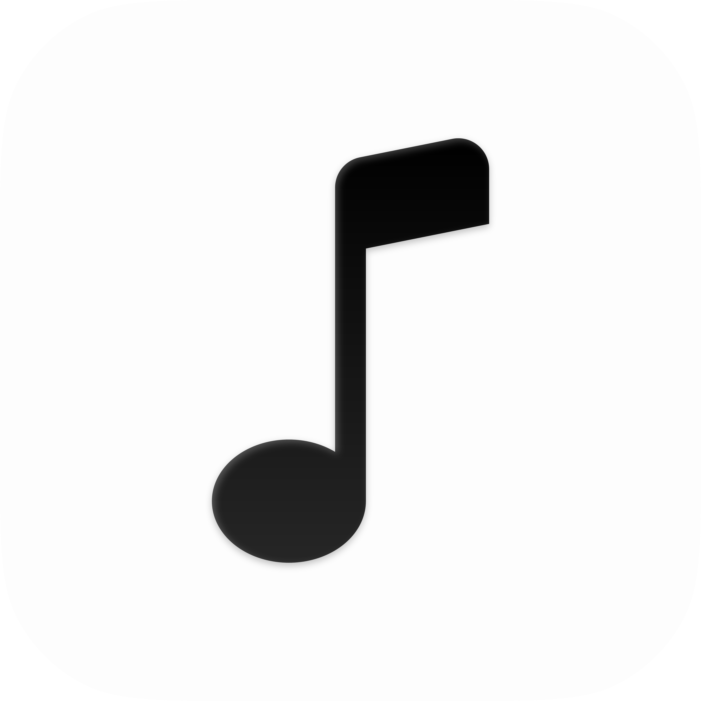

  
  <h1>Morgana</h1>

  
Un reproductor de FLAC para iOS con estética moderna. Sin anuncios y gratis.

## Instalar en el iPhone desde Windows

- Instala [Sideloadly](https://sideloadly.io). También se necesita iTunes, pero la versión de la web de Apple.

- Conecta el iPhone por USB, arrastra `Morgana.ipa` a Sideloadly, escribe tu Apple ID y pulsa *Start*.

- En iOS 16 o superior activa el **Modo de desarrollador** en Ajustes → Privacidad y seguridad → Modo de desarrollador.

- Ajustes → General → VPN y gestión de dispositivos → confía en tu Apple ID.

Con un Apple ID gratuito la firma **caduca a los 7 días** y hay un máximo de 3 apps instaladas así. Sideloadly puede restaurar la firma. Si caduca, vuelve a instalar el `.ipa`.

## Uso

- Abre la app → pestaña **Configuración** → **Añadir carpeta** y elige donde tienes los FLAC.
  
- Espera al escaneo. La biblioteca aparece en el resto de pestañas.
  
- Si añades música nueva, usa **Volver a escanear**.

## Estado

La aplicación no se compila de manera local, sino que se utiliza GitHub Actions, ya que no tengo un dispositivo con macOS.

## Cómo se trata la privacidad

Morgana se diseñó pensando en la privacidad del usuario.

- No se recopilan datos personales.

- No se utiliza analítica ni ningún sistema de seguimiento.

- No se muestra publicidad.

- No es necesario crear una cuenta.

- No se solicitan permisos innecesarios.

Morgana utiliza tecnologías nativas de Apple, como  _AVPlayer_ para la reproducción de audio y el selector de documentos de iOS para seleccionar archivos desde ubicaciones como iCloud Drive.

En los ajustes de iOS puede aparecer que Morgana tiene acceso a datos móviles debido a las capacidades de red de _AVPlayer_ y a la integración con iCloud Drive. Puedes desactivar el acceso a datos móviles desde los ajustes de tu iPhone y Morgana seguirá funcionando con normalidad para reproducir tu música almacenada localmente.

## Copyright

Morgana — Copyright © 2026 tortilla de patatas

Este programa es software libre. Puedes redistribuirlo y modificarlo bajo los términos de la Licencia Pública General de GNU, versión 3, publicada por la Free Software Foundation. Se distribuye sin ninguna garantía. Consulta el archivo LICENSE para más detalles.
